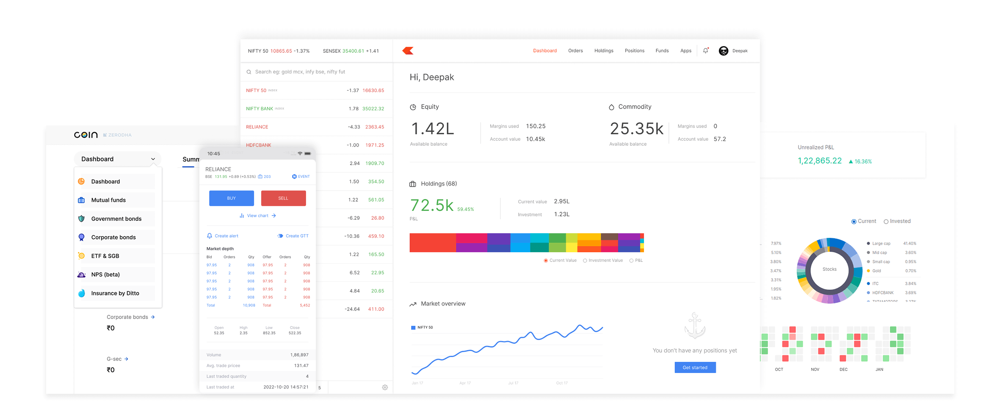
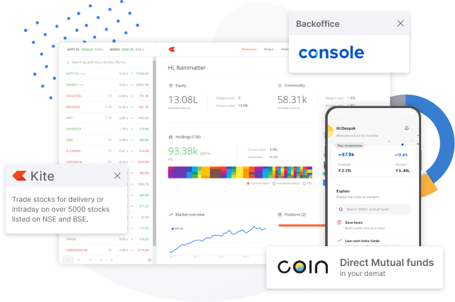
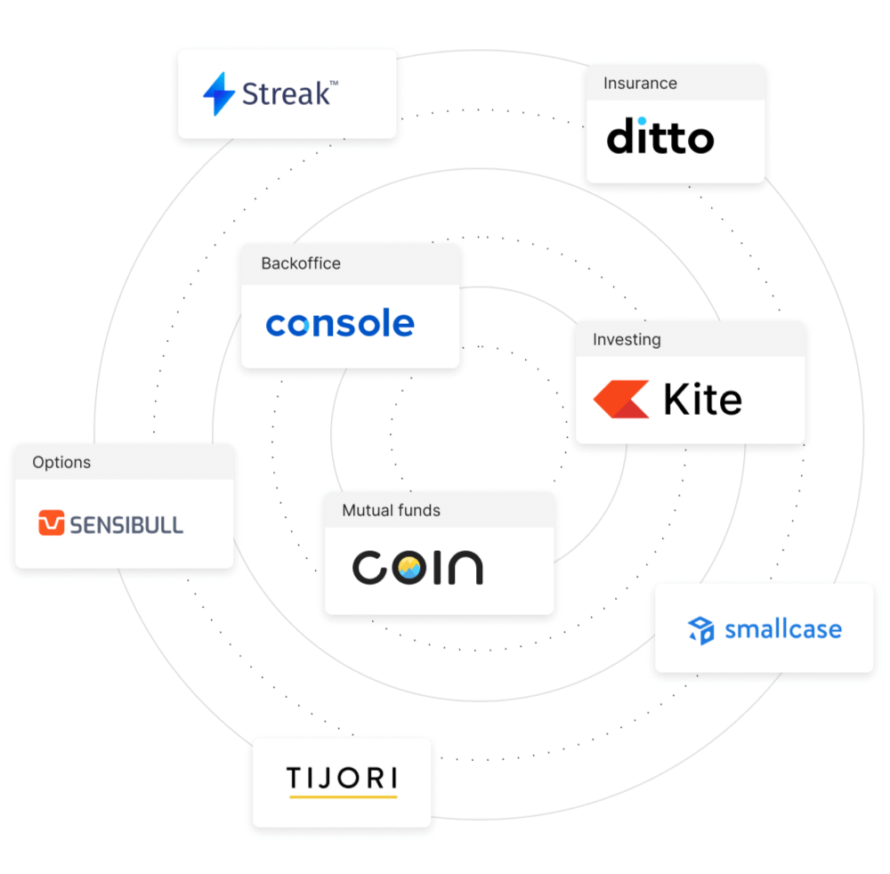

# Nexora Landing Frontend

This is the marketing/landing frontend for the Nexora trading platform. It includes the home page, pricing, products, support, signup, and login flows.

## Tech Stack
- React
- Create React App
- React Router
- Bootstrap
- Font Awesome
- Axios

## Features
- Modern landing page
- Product overview section
- Pricing page
- Support page
- About page
- Signup and login pages
- Redirect to dashboard after authentication

## Screenshots

### Home page


### Signup page


### Product showcase


## Project Structure
```bash
frontend/
├── public/
├── src/
│   ├── landing_page/
│   ├── index.js
│   └── index.css
├── .env
├── .gitignore
├── package.json
└── README.md
```

## Prerequisites
- Node.js 18+
- npm
- Backend API running locally or remotely

## Installation
```bash
cd frontend
npm install
```

## Environment Variables
Create a `.env` file inside the frontend folder:

```bash
REACT_APP_DASHBOARD_URL=http://localhost:5173
```

This is used so the login/signup flows can redirect users into the dashboard app.

## Run locally
```bash
npm start
```

The app usually runs on:
```bash
http://localhost:3000
```

## Routing Overview
```bash
/
/signup
/login
/about
/products
/pricing
/support
/dashboard
```

The `/dashboard` route redirects the user to the separate dashboard application.

## Screenshots

### Home page


### Login page


### Signup page


### Dashboard redirect flow


> Note: Add the screenshot files under `frontend/public/media/` if you want them to display properly in GitHub.

## Notes
- This project is meant to serve as the public-facing/trading platform landing experience.
- Real authentication depends on the backend API being available.
- In case of backend failure, the app can still redirect users to the dashboard in demo mode.

## License
For educational and demo use.
